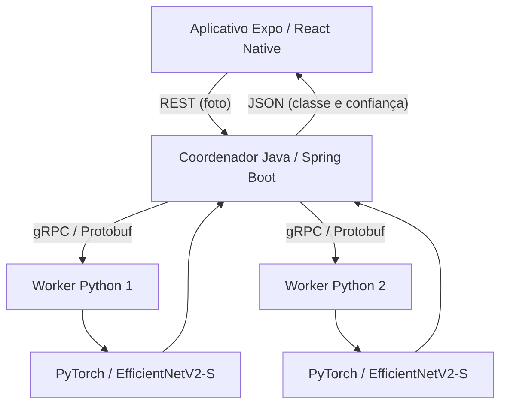

# Classificação Automática de Resíduos Sólidos


Trabalho Interdisciplinar VI (TI6) da Ciência da Computação da **PUC Minas**.

Estamos desenvolvendo um sistema que recebe fotografias de resíduos e identifica o material em uma de seis categorias. O trabalho também investiga o desempenho do processamento em execuções sequenciais, paralelas e distribuídas.

As três disciplinas envolvidas são **Processamento e Análise de Imagens**, **Computação Paralela** e **Computação Distribuída**.

## O que o projeto classifica?

A base utilizada reúne **15.114 imagens** e seis categorias:

| Classe no código | Categoria |
|---|---|
| `battery` | Bateria |
| `glass` | Vidro |
| `metal` | Metal |
| `organic` | Orgânico |
| `paper` | Papel (incluindo papelão) |
| `plastic` | Plástico |

A base de imagens e os pesos treinados do modelo não são incluídos no GitHub.

## Arquitetura



O aplicativo, criado pelo Diego, tira ou seleciona a fotografia e mostra a resposta. O coordenador Java distribui as imagens, acompanha tempos e reúne os resultados. Os workers usam PyTorch para realizar a classificação.

**Modelo escolhido:** EfficientNetV2-S, inicialmente com pesos pré-treinados no ImageNet e ajuste para as seis categorias.

**Comunicação:** REST do aplicativo para Java; gRPC de Java para os workers. O repositório também mantém rotas REST internas para comparação de protocolos, mas o uso normal do aplicativo já aponta para gRPC.

Os dois workers definidos no Docker Compose rodam inicialmente no mesmo computador. Isso valida a integração entre processos, mas não deve ser confundido com ganho obtido entre máquinas físicas independentes.

## Requisitos para rodar

- Docker com Docker Compose para o backend e os workers;
- Node.js LTS, npm e Expo Go para o aplicativo;
- Python 3.11 e um ambiente PyTorch com CUDA para treinamento na RTX 3060;
- Java 17 e Maven somente se quiser executar o coordenador fora do Docker.

## Iniciando o servidor

Clone o projeto:

```bash
git clone https://github.com/FelipeSilva96/Trabalho-Interdisciplinar-VI.git
cd Trabalho-Interdisciplinar-VI
```

Inicie os serviços:

```bash
docker compose up --build
```

Serão iniciados um coordenador Java e dois workers Python. A primeira compilação pode demorar por causa das dependências de IA.

Em outro terminal, confira:

```bash
curl http://localhost:8080/api/v1/health
curl http://localhost:8080/api/v1/categories
curl http://localhost:8080/api/v1/workers/health
```

Teste uma imagem pela comunicação gRPC:

```bash
curl -X POST "http://localhost:8080/api/v1/classifications?strategy=distributed&protocol=grpc" -F "files=@foto.jpg"
```

Se o modelo ainda não estiver presente, os workers responderão `MODEL_NOT_LOADED`. Isso significa que o caminho de comunicação foi executado, mas **não é uma previsão real**.

Para parar:

```bash
docker compose down
```

## Testando o aplicativo do Diego

Abra outro terminal e entre na pasta do aplicativo:

```bash
cd frontEnd
npm ci
```

Crie um arquivo chamado `.env` dentro de `frontEnd`:

```env
EXPO_PUBLIC_API_URL=http://192.168.1.100:8080
```

Substitua o IP pelo endereço real do computador onde o Java está rodando. No Windows, execute `ipconfig`; no Linux, `hostname -I`.

Com o backend iniciado, abra `http://IP_DO_PC:8080/api/v1/health` no navegador do celular. Se não abrir, confira a rede e o firewall antes de testar o aplicativo.

Depois execute:

```bash
npx expo start -c
```

Abra o projeto usando o Expo Go. Você poderá tirar uma foto ou escolher uma da galeria, confirmar a imagem e pressionar **Classificar**. A tela final mostra a categoria e a confiança quando o modelo está disponível, ou informa que ainda não existe uma previsão válida.

A comunicação entre o celular e o computador precisa estar acessível por rede. No celular físico, `localhost` aponta para o próprio telefone, não para o PC.

## Treinando a EfficientNetV2-S — parte do Mateus

O treinamento principal está previsto para a máquina com **RTX 3060 (6 GB de VRAM) e 32 GB de RAM**. O modelo final ainda precisa ser treinado, testado e validado.

A base deve estar organizada assim:

```text
Base_unica/
├── battery/
├── glass/
├── metal/
├── organic/
├── paper/
└── plastic/
```

Dentro da pasta `ml-worker`, crie um ambiente virtual com Python 3.11, instale PyTorch com suporte CUDA conforme a documentação oficial e as dependências de `requirements.txt`. Confirme que `torch.cuda.is_available()` retorna `True`.

Exemplo de execução inicial:

```bash
cd ml-worker
python training/train.py --data /caminho/para/Base_unica --epochs 10 --batch-size 4 --output models/waste_efficientnet_v2_s.pt
```

Esse é um ponto de partida, não um treinamento validado. Antes dos resultados finais, precisamos verificar duplicatas, usar divisões estratificadas, avaliar Macro-F1 e estudar mixed precision para melhorar a utilização dos 6 GB de VRAM.

O checkpoint deve ser salvo em:

```text
ml-worker/models/waste_efficientnet_v2_s.pt
```

Depois, reinicie os workers:

```bash
docker compose restart worker-1 worker-2
```

**Atenção à GPU:** a configuração padrão do Docker Compose não habilita automaticamente CUDA dentro dos contêineres. Para inferência na RTX 3060 com Docker, configure NVIDIA Container Toolkit e acesso à GPU. Também é possível executar um worker diretamente na máquina com NVIDIA e apontar `WORKER_GRPC_URLS` para seu endereço.

## Organização do repositório

```text
backend/           Coordenador Java e cliente gRPC
ml-worker/         Inferência Python, treinamento e modelos
frontEnd/          Aplicativo em Expo / React Native
proto/             Contrato gRPC compartilhado
dataset/           Instruções sobre a base
docs/              Documentação
scripts/           Scripts de teste e benchmark
docker-compose.yml Configuração dos serviços locais
```

## O que vamos medir?

- Qualidade da classificação: acurácia, precisão, recall, Macro-F1 e matriz de confusão;
- Desempenho: tempo de execução, speedup, eficiência e imagens por segundo;
- Distribuição: comparação entre um ou mais workers e custo de comunicação.

O arquivo `benchmark_results.csv` contém resultados preliminares de execução. Eles **não comprovam a qualidade da EfficientNetV2-S**, nem substituem os experimentos finais com modelo treinado e ambiente registrado.

## Equipe

- Felipe Pereira da Silva
- Rikerson Antonio Freitas
- Diego Feitosa Ferreira dos Santos
- Mateus Resende Ottoni

## Situação atual

O frontend e a infraestrutura Java/Python estão em integração; a EfficientNetV2-S foi escolhida, mas o treinamento e a avaliação experimental ainda não foram concluídos. O foco da Sprint 2 é mostrar o avanço, as dificuldades encontradas e o que será validado em seguida.

---

Este é um projeto acadêmico em desenvolvimento, sujeito a ajustes conforme os testes e as orientações dos professores.
