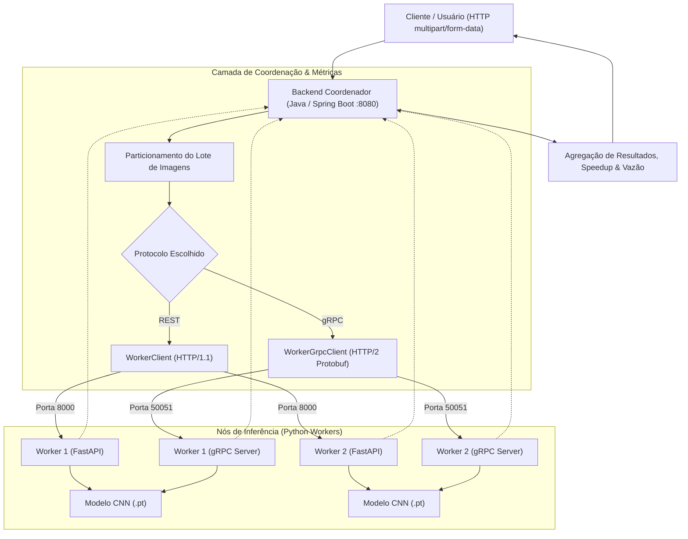

# Classificação Automática de Resíduos Sólidos


Projeto desenvolvido para o **Trabalho Interdisciplinar VI do curso de Ciência da Computação da PUC Minas**.

O objetivo principal do projeto é classificar imagens de resíduos sólidos e, simultaneamente, estudar empiricamente o comportamento computacional do processamento em execuções **sequenciais, paralelas e distribuídas**, bem como o impacto do protocolo de transporte (**REST vs. gRPC**).

---

## O que queremos investigar

A pergunta central da pesquisa é: **quanto conseguimos acelerar a classificação de um grande conjunto de imagens sem perder a acurácia das previsões?**

O trabalho integra as três áreas fundamentais do semestre:

- **Processamento e Análise de Imagens:** preparação das imagens, data augmentation e classificação com CNN (MobileNetV3 / EfficientNetV2);
- **Computação Paralela:** processamento em lotes (*batches*), uso intensivo de múltiplos núcleos de CPU e GPU/CUDA;
- **Computação Distribuída:** particionamento de carga entre nós de processamento (*workers*) independentes, agregação de resultados e análise do overhead de comunicação em rede (REST sobre HTTP/1.1 vs. gRPC sobre HTTP/2).

As seis categorias de resíduos suportadas são:

`battery` · `glass` · `metal` · `organic` · `paper` · `plastic`

---

## Arquitetura do Sistema

O sistema segue a arquitetura **Mestre-Trabalhador (Master-Worker)** com desacoplamento completo entre a coordenação e o processamento de visão computacional:



---

## Requisitos Prévios

Para rodar a aplicação completa, você pode optar pela execução via **Docker (Recomendada)** ou **Manual no Host**:

| Requisito | Versão Mínima | Uso |
| :--- | :--- | :--- |
| **Docker Desktop** | 4.x ou superior | Execução completa com 1 comando (coordenador + workers) |
| **Python** | 3.11 ou superior | Treinamento do modelo e execução local dos workers |
| **Java (JDK)** | 17 ou superior | Execução local do backend Java |
| **Maven** | 3.9 ou superior | Compilação local do backend Java (se executado sem Docker) |

---

## Guia de Instalação e Execução do Zero

### Passo 1: Clonar o Repositório

```bash
git clone https://github.com/rikerson/Trabalho-Interdisciplinar-VI.git
cd Trabalho-Interdisciplinar-VI
```

---

### Passo 2: Treinamento do Modelo (Opcional, mas Recomendado)

> [!NOTE]
> Os pesos treinados do modelo (`.pt`) **não são versionados no Git** devido ao tamanho. Se você iniciar o sistema sem treinar o modelo, todos os endpoints funcionarão normalmente, mas retornarão o status `MODEL_NOT_LOADED`.

1. **Organize o dataset** em pastas com os nomes exatos das categorias:
   ```text
   dataset/Train_base/
   ├── battery/
   ├── glass/
   ├── metal/
   ├── organic/
   ├── paper/
   └── plastic/
   ```

2. **Crie o ambiente virtual Python e instale as dependências**:
   * No **Windows (PowerShell)**:
     ```powershell
     cd ml-worker
     python -m venv .venv
     .\.venv\Scripts\python.exe -m pip install -r requirements.txt
     ```
   * No **Linux/macOS**:
     ```bash
     cd ml-worker
     python3 -m venv .venv
     source .venv/bin/activate
     pip install -r requirements.txt
     ```

3. **Gere os stubs do Protobuf/gRPC para o Python**:
   * No **Windows (PowerShell)**:
     ```powershell
     .\.venv\Scripts\python.exe -m grpc_tools.protoc -I../proto --python_out=app/proto --grpc_python_out=app/proto ../proto/waste_inference.proto
     ```
   * No **Linux/macOS**:
     ```bash
     python3 -m grpc_tools.protoc -I../proto --python_out=app/proto --grpc_python_out=app/proto ../proto/waste_inference.proto
     ```

4. **Execute o script de treinamento**:
   * No **Windows (PowerShell)**:
     ```powershell
     .\.venv\Scripts\python.exe training/train.py --data "..\dataset\Train_base" --epochs 10 --output "models/waste_mobilenet.pt"
     ```
   * No **Linux/macOS**:
     ```bash
     python3 training/train.py --data "../dataset/Train_base" --epochs 10 --output "models/waste_mobilenet.pt"
     ```
   * Volte para a raiz do repositório:
     ```bash
     cd ..
     ```

---

### Passo 3: Executando a Aplicação

#### Opção A: Execução com Docker (Recomendada)

1. Certifique-se de que o **Docker Desktop** está aberto e rodando.
2. Na raiz do repositório, execute:
   ```bash
   docker compose up --build
   ```

3. Portas expostas no seu computador:
   * **Backend Coordenador:** `http://localhost:8080`
   * **Worker 1:** REST `http://localhost:8001` \| gRPC `localhost:50051`
   * **Worker 2:** REST `http://localhost:8002` \| gRPC `localhost:50052`

4. Para parar a aplicação:
   ```bash
   docker compose down
   ```

---

#### Opção B: Execução Local sem Docker (Desenvolvimento)

Se preferir rodar cada serviço em um terminal separado:

* **Terminal 1 — Worker 1 (Portas 8001 e 50051):**
  ```powershell
  cd ml-worker
  $env:WORKER_ID="worker-1"
  $env:GRPC_PORT="50051"
  .\.venv\Scripts\python.exe -m uvicorn app.main:app --host 0.0.0.0 --port 8001
  ```

* **Terminal 2 — Worker 2 (Portas 8002 e 50052):**
  ```powershell
  cd ml-worker
  $env:WORKER_ID="worker-2"
  $env:GRPC_PORT="50052"
  .\.venv\Scripts\python.exe -m uvicorn app.main:app --host 0.0.0.0 --port 8002
  ```

* **Terminal 3 — Backend Java:**
  ```powershell
  cd backend
  $env:WORKER_URLS="http://localhost:8001,http://localhost:8002"
  $env:WORKER_GRPC_URLS="localhost:50051,localhost:50052"
  mvn spring-boot:run
  ```

---

## Executando as Funções da Aplicação (Endpoints da API)

### 1. Verificação de Saúde do Coordenador
Verifica o status da API principal e a quantidade de workers registrados:
```bash
curl http://localhost:8080/api/v1/health
```
*Resposta esperada:* `{"service":"waste-coordinator","restWorkers":2,"grpcWorkers":2,"status":"UP"}`

---

### 2. Verificação de Saúde dos Workers (REST e gRPC)
Testa a conectividade com cada worker via HTTP REST e canais gRPC:
```bash
curl http://localhost:8080/api/v1/workers/health
```

---

### 3. Consulta de Categorias Suportadas
```bash
curl http://localhost:8080/api/v1/categories
```
*Resposta esperada:* `["battery","glass","metal","organic","paper","plastic"]`

---

### 4. Classificação Distribuída de Imagens

Você pode enviar uma ou várias imagens para classificação balanceada entre os workers.

#### A. Via gRPC (Alta Performance / HTTP/2 - Recomendado)
```powershell
curl -X POST "http://localhost:8080/api/v1/classifications?strategy=distributed&protocol=grpc" `
  -F "files=@dataset/Train_base/battery/battery1.jpg" `
  -F "files=@dataset/Train_base/battery/battery10.jpg"
```

#### B. Via REST (HTTP/1.1 Multipart Tradicional)
```powershell
curl -X POST "http://localhost:8080/api/v1/classifications?strategy=distributed&protocol=rest" `
  -F "files=@dataset/Train_base/battery/battery1.jpg" `
  -F "files=@dataset/Train_base/battery/battery10.jpg"
```

*Exemplo de resposta:*
```json
{
  "strategy": "distributed-grpc",
  "imageCount": 2,
  "workersUsed": 2,
  "elapsedMs": 242.68,
  "throughputImagesPerSecond": 8.24,
  "workerResults": [
    {
      "workerId": "worker-1",
      "modelLoaded": true,
      "elapsedMs": 226.66,
      "predictions": [
        {
          "filename": "battery1.jpg",
          "status": "OK",
          "label": "battery",
          "confidence": 0.6264
        }
      ]
    },
    {
      "workerId": "worker-2",
      "modelLoaded": true,
      "elapsedMs": 220.92,
      "predictions": [
        {
          "filename": "battery10.jpg",
          "status": "OK",
          "label": "battery",
          "confidence": 0.4348
        }
      ]
    }
  ]
}
```

---

### 5. Comparação Sequencial vs. Distribuído (Speedup)
Executa o mesmo lote sequencialmente em 1 worker e distribuído em múltiplos workers, calculando o **speedup ($S = T_1 / T_2$)**:

```powershell
curl -X POST "http://localhost:8080/api/v1/experiments/compare?protocol=grpc" `
  -F "files=@dataset/Train_base/battery/battery1.jpg" `
  -F "files=@dataset/Train_base/battery/battery10.jpg" `
  -F "files=@dataset/Train_base/battery/battery11.jpg" `
  -F "files=@dataset/Train_base/battery/battery12.jpg"
```

---

### 6. Comparação de Protocolos: REST vs. gRPC
Mede o impacto da camada de transporte e serialização comparando as duas abordagens sob a mesma carga:

```powershell
curl -X POST "http://localhost:8080/api/v1/experiments/compare-protocols" `
  -F "files=@dataset/Train_base/battery/battery1.jpg" `
  -F "files=@dataset/Train_base/battery/battery10.jpg"
```

*Retorna o tempo de cada protocolo e o ganho percentual/speedup obtido com gRPC.*

---

## Benchmark Automatizado Experimental

Para gerar medições estatísticas e exportar resultados em formato de planilha para relatórios e artigos, utilize o script automatizado [`scripts/benchmark.py`](scripts/benchmark.py):

```powershell
.\ml-worker\.venv\Scripts\python.exe scripts/benchmark.py --protocol grpc --runs 3
```

O script:
1. Executa uma rodada de aquecimento (*warmup*);
2. Testa potências de 2 (lotes de 2, 4, 8, 16 e 32 imagens);
3. Executa cada tamanho $k$ vezes e calcula a média;
4. Exibe na tela o cálculo de **Speedup** e **Eficiência Paralela**;
5. Exporta todos os dados brutos para o arquivo `benchmark_results.csv`.

---

## Estrutura do Repositório

```text
.
├── backend/                  # Coordenador e API principal (Java 17, Spring Boot, gRPC Client)
│   ├── src/main/java/        # Código-fonte Java (controllers, services, clients)
│   ├── src/main/proto/       # Cópia do contrato Protobuf para o build Maven
│   └── pom.xml               # Dependências do Spring Boot e plugin de compilação Protobuf
├── ml-worker/                # Nó de inferência e treinamento (Python, FastAPI, PyTorch, gRPC Servicer)
│   ├── app/                  # Servidor de inferência (REST na porta 8000 e gRPC na 50051)
│   ├── models/               # Armazena os pesos do modelo (waste_mobilenet.pt)
│   ├── training/             # Scripts de treinamento com PyTorch
│   └── requirements.txt      # Dependências Python (Torch, Torchvision, FastAPI, gRPC)
├── proto/                    # Contrato canônico gRPC (waste_inference.proto)
├── dataset/                  # Instruções de organização do conjunto de dados
├── docs/                     # Arquitetura, exemplos de chamadas e referências acadêmicas
├── scripts/                  # Scripts utilitários e benchmarks automatizados (benchmark.py)
├── .github/workflows/        # Pipelines de integração contínua (CI)
├── docker-compose.yml        # Orquestração dos 3 contêineres locais
└── README.md                 # Documentação principal
```

---

## Equipe

- Diego Feitosa Ferreira dos Santos
- Felipe Pereira da Silva
- Kauan Gabriel Silva Pereira
- Mateus Resende Ottoni
- Rikerson Antonio Freitas

## Referências Científicas

As referências bibliográficas do trabalho estão reunidas em [`docs/references.md`](docs/references.md).
